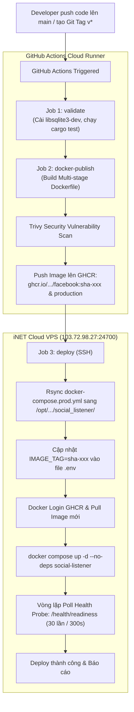

# HƯỚNG DẪN TRIỂN KHAI SOCIAL LISTENER (FACEBOOK) LÊN SERVER UBUNTU 24.04 CHẠY CÙNG DOCKER VỚI ANTHILL BACKEND & HƯỚNG DẪN TRÍCH XUẤT COOKIE FACEBOOK TRÊN ĐIỆN THOẠI

> **Tài liệu kỹ thuật đồng bộ với:** `huong-dan-trien-khai-production-ubuntu-24-04.md`  
> **Hệ sinh thái:** Tổ Kiến Adventure (Trekking & Outdoor Services)  
> **Thành phần:** Social Listener (Facebook & Threads Lead Generation Engine - 100% Thuần Rust + Headless Chrome CDP)  
> **Máy chủ đích:** iNET Cloud Server Linux 5 (`CS-Linux-20260903221631212` - IP: `103.72.98.27` - Port SSH: `24700`)  
> **Hệ điều hành:** Ubuntu 24.04 LTS (x86_64) | 3 Core vCPU | 6 GB RAM | 80 GB SSD  

---

## MỤC LỤC

1. [Tổng Quan Kiến Trúc & Kết Nối Hai Chiều (Overview & Topology)](#1-tổng-quan-kiến-trúc--kết-nối-hai-chiều)
2. [Rà Soát Mã Nguồn & Các Điểm Cần Lưu Ý (Codebase Review)](#2-rà-soát-mã-nguồn--các-điểm-cần-lưu-ý)
3. [Cấu Hình Môi Trường & Bảo Mật Hai Chiều (.NET API $\leftrightarrow$ Rust Social)](#3-cấu-hình-môi-trường--bảo-mật-hai-chiều)
4. [Hướng Dẫn Triển Khai Chi Tiết Lên Server Ubuntu (Deployment Guide)](#4-hướng-dẫn-triển-khai-chi-tiết-lên-server-ubuntu)
   - [Phương Án 1: Tích hợp vào file `compose.prod.yml` gốc](#phương-án-1-tích-hợp-vào-composeprodyml-gốc)
   - [Phương Án 2: Triển khai độc lập nhưng chung mạng `anthill_prod_net`](#phương-án-2-triển-khai-độc-lập-chung-mạng-anthill_prod_net)
   - [Phương Án 3 (Khuyên Dùng Cho Production): Tự động hóa CI/CD với GitHub Actions & GHCR](#phương-án-3-khuyên-dùng-cho-production-tự-động-hóa-cicd-với-github-actions--ghcr-tương-tự-anthill-backend)
5. [Kiểm Thử Nghiệm Thu Sau Khi Triển Khai (Verification & Smoke Tests)](#5-kiểm-thử-nghiệm-thu-sau-khi-triển-khai)
6. [Hướng Dẫn Trích Xuất Cookie Facebook Trên Điện Thoại (Tương Tự Cookie-Editor)](#6-hướng-dẫn-trích-xuất-cookie-facebook-trên-điện-thoại)
   - [Bản chất kỹ thuật quan trọng của Cookie Facebook](#61-bản-chất-kỹ-thuật-quan-trọng-của-cookie-facebook)
   - [Cách 1 (Android - Chuẩn 100% PC): Dùng Kiwi Browser + Cookie-Editor](#62-cách-1-trên-android-dùng-kiwi-browser--cookie-editor)
   - [Cách 2 (iOS / iPhone): Dùng Orion Browser + Cookie-Editor](#63-cách-2-trên-ios-iphone--ipad-dùng-orion-browser--cookie-editor)
   - [Cách 3: Nạp nhanh định dạng JSON tối giản (c_user & xs)](#64-cách-3-nạp-nhanh-định-dạng-json-tối-giản-c_user--xs)
   - [Cách nạp Cookie vào hệ thống trực tiếp từ điện thoại](#65-cách-nạp-cookie-vào-hệ-thống-trực-tiếp-từ-điện-thoại)
7. [Sổ Tay Xử Lý Sự Cố Thường Gặp (Troubleshooting Runbook)](#7-sổ-tay-xử-lý-sự-cố-thường-gặp)

---

## 1. TỔNG QUAN KIẾN TRÚC & KẾT NỐI HAI CHIỀU

### 1.1 Sơ đồ mạng Docker nội bộ (Bridge Network: `anthill_prod_net`)

Hệ thống Social Listener được đóng gói thành container Docker và đặt **chạy trong cùng mạng Docker `anthill_prod_net`** với cụm Backend Tổ Kiến (`api`, `mysql`, `redis`, `minio`).

```text
┌────────────────── Server Ubuntu 24.04 LTS (Host: 103.72.98.27) ──────────────────────────┐
│                                                                                           │
│  Tường lửa UFW: Chỉ mở SSH (Port 24700), HTTP (80), HTTPS (443)                           │
│  Nginx Reverse Proxy: api.tokienadventure.vn ──► 127.0.0.1:8080 (Anthill Backend API)      │
│                                                                                           │
│  Mạng Nội Bộ Docker: anthill_prod_net (Không mở port dịch vụ ra ngoài Internet)           │
│  ┌─────────────────────────────────────────────────────────────────────────────────────┐  │
│  │                                                                                     │  │
│  │   [ anthill_prod_api ] (ASP.NET Core 10 Web API - Port 8080)                        │  │
│  │     │       ▲                                                                       │  │
│  │     │ (2)   │ (1) HTTP POST Webhook: /api/v1/webhooks/social-leads                  │  │
│  │     │ Admin │     Header: Authorization: Bearer <SOCIAL_WEBHOOK_TOKEN>              │  │
│  │     │ Proxy │     Header: Idempotency-Key: <event_key>                              │  │
│  │     ▼       │                                                                       │  │
│  │   [ anthill_prod_social_listener ] (Rust Axum Engine + Headless Chrome - Port 8000) │  │
│  │     │                                                                               │  │
│  │     ├──► SQLite DB (Persistent: /app/data/social_listener.db)                       │  │
│  │     ├──► Chrome Profile (Persistent: /app/runtime/profile)                          │  │
│  │     └──► In-memory CDP Controller (Port 9222 nội bộ container)                     │  │
│  │                                                                                     │  │
│  │   [ anthill_prod_mysql ] (MySQL 8.4 LTS - Database `trekking_trip`)                 │  │
│  │   [ anthill_prod_redis ] (Redis 8 Alpine)                                           │  │
│  │   [ anthill_prod_minio ] (MinIO S3 Media Storage)                                   │  │
│  │                                                                                     │  │
│  └─────────────────────────────────────────────────────────────────────────────────────┘  │
└───────────────────────────────────────────────────────────────────────────────────────────┘
```

### 1.2 Luồng giao tiếp hai chiều (Bidirectional Communication)

| Luồng kết nối | Bên gửi | Bên nhận | Địa chỉ gọi trong Docker | Mục đích & Nghiệp vụ |
|---|---|---|---|---|
| **Chiều 1 (Social $\to$ BE)** | `social-listener` | `anthill_prod_api` | `http://anthill_prod_api:8080/api/v1/webhooks/social-leads` | Gửi dữ liệu khách hàng tiềm năng (Leads) phát hiện được trên Facebook, hoặc gửi cảnh báo khẩn cấp `social_session_expired` khi cookie hết hạn để BE bắn Web Push tới Admin. |
| **Chiều 2 (BE $\to$ Social)** | `anthill_prod_api` | `social-listener` | `http://anthill_prod_social_listener:8000` | Admin CRM gọi lấy trạng thái phiên (`/api/session/status`), nạp Cookie mới (`/api/session/import`), bật/tắt nhóm (`/api/targets/:id/toggle`), kích hoạt cào ngay (`/api/targets/:id/crawl-now`), xem bài viết & logs. |

### 1.3 Phân bổ tài nguyên trên Server iNET (3 vCPU / 6 GB RAM + 4 GB SWAP)

Hệ thống có tổng cộng **6 GB RAM vật lý + 4 GB SWAP = 10 GB bộ nhớ khả dụng**:

| Dịch vụ Container | Memory Limit (Giới hạn trần) | CPU Limit | Ghi chú vận hành |
|---|---|---|---|
| **`anthill_prod_mysql`** | `1536 MB` (1.5 GB) | `1.0 vCPU` | MySQL 8.4 InnoDB buffer pool 1024MB |
| **`anthill_prod_api`** | `1024 MB` (1.0 GB) | `1.0 vCPU` | ASP.NET Core 10 Web API |
| **`anthill_prod_social_listener`** | `1024 MB` (1.0 GB) | `1.5 vCPU` | Rust Native (<60MB) + Headless Chrome (~250-400MB) |
| **`anthill_prod_minio`** | `512 MB` (0.5 GB) | `0.5 vCPU` | MinIO Media storage S3 |
| **`anthill_prod_redis`** | `384 MB` | `0.25 vCPU` | Redis LRU cache |
| **Hệ điều hành + Nginx** | ~`1000 MB` | Không giới hạn | Ubuntu OS, SSH, Nginx host |
| **TỔNG CỘNG** | **~4.4 GB / 6.0 GB RAM** | — | **Dư dôi an toàn ~1.6 GB RAM vật lý + 4 GB SWAP dự phòng!** |

---

## 2. RÀ SOÁT MÃ NGUỒN & CÁC ĐIỂM CẦN LƯU Ý

Sau khi rà soát toàn bộ mã nguồn tại `social_notification/facebook`, các điểm kỹ thuật cốt lõi đã được kiểm tra và chuẩn hóa như sau:

### 2.1 File `Dockerfile`
- **Multi-stage Build:**
  - Stage 1: `rust:slim-bookworm` biên dịch binary tĩnh tối ưu release với BuildKit caching (`cargo build --release`).
  - Stage 2: `debian:bookworm-slim` cài đặt Google Chrome Stable chính thức, Python 3 (phục vụ script CDP inject), `sqlite3`, và **`procps`** (bổ sung công cụ `pgrep`, `pkill` cho script tái khởi động Chrome).
- **Anti-sandbox Flags:** File cấu hình Chrome được gán `--no-sandbox --disable-dev-shm-usage --disable-gpu` phù hợp chạy trong Docker Linux.
- **Shared Memory:** Bắt buộc cấu hình `shm_size: "1gb"` trong docker compose để Chrome không bị sập (crash do cạn kiệt `/dev/shm` mặc định 64MB).

### 2.2 Các File Scripts trong thư mục `bin/`
- **`bin/fb`:** Binary ELF 64-bit x86_64 của `facebook-cli`, kết nối Chrome DevTools Protocol.
- **`bin/entrypoint.sh`:** Script khởi chạy chính. Đã được bổ sung lệnh tự động `chmod +x /app/bin/*` phòng ngừa trường hợp volume mount từ host làm mất quyền thực thi.
- **`bin/recycle_chrome.sh`:** Script dọn dẹp bộ nhớ Chrome: tự động kết thúc Chrome cũ bằng SIGTERM/SIGKILL, xóa cache tạm thời nhưng **bảo lưu 100% dữ liệu cookies và profile**, khởi động Chrome mới với cờ chống phát hiện.
- **`bin/inject_cookies.py`:** Script nạp cookie trực tiếp vào Chrome memory cookie jar qua giao thức CDP WebSocket (`Network.setCookies`), hỗ trợ chuyển đổi linh hoạt cả định dạng mảng JSON chuẩn của Cookie-Editor lẫn Object `{ c_user, xs }`.

### 2.3 Định Dạng Xuống Dòng (Line Endings)
> [!IMPORTANT]
> Khi copy mã nguồn từ máy Windows lên Ubuntu, các file `.sh` có thể bị chuyển thành định dạng CRLF (`\r\n`), gây ra lỗi kinh điển `/bin/bash\r: bad interpreter`.  
> File `Dockerfile` đã tích hợp sẵn lệnh `sed -i 's/\r$//' /app/bin/*.sh` để tự động khử bỏ `\r`, đảm bảo script luôn thực thi trơn tru trên Linux.

---

## 3. CẤU HÌNH MÔI TRƯỜNG & BẢO MẬT HAI CHIỀU

Hai dịch vụ giao tiếp nội bộ với nhau trong mạng Docker thông qua **Shared Secret Bearer Token**:

### 3.1 Ma Trận Cấu Hình Biến Môi Trường

| Tên Biến Môi Trường | Dịch Vụ Sử Dụng | Giá Trị Production Mẫu | Ý Nghĩa Kỹ Thuật |
|---|---|---|---|
| `TO_KIEN_WEBHOOK_URL` | `social-listener` | `http://anthill_prod_api:8080/api/v1/webhooks/social-leads` | Địa chỉ Webhook API để Social đẩy Lead về. Gọi thẳng qua tên container nội bộ. |
| `TO_KIEN_TOKEN` | `social-listener` | Chuỗi bí mật (ví dụ sinh bằng `openssl rand -hex 24`) | Bearer token gửi kèm trong HTTP Header `Authorization`. |
| `SocialListener__BaseUrl` | `api` (.NET) | `http://social-listener:8000` | Địa chỉ nội bộ để Backend API gọi sang điều khiển Social Listener. |
| `SocialListener__WebhookToken`| `api` (.NET) | Phải trùng khớp với `TO_KIEN_TOKEN` | Token bí mật dùng để xác thực các request Webhook gửi tới. |
| `DATABASE_URL` | `social-listener` | `sqlite:///app/data/social_listener.db?mode=rwc` | Đường dẫn CSDL SQLite bền vững trong container. |
| `CRAWL_INTERVAL_SECONDS` | `social-listener` | `300` (5 phút) | Chu kỳ quét mặc định mỗi nhóm (có tự động Jitter ±5%). |
| `MAX_POSTS_PER_CRAWL` | `social-listener` | `5` | Quét 5 bài viết mới nhất mỗi lần để giảm thời gian xử lý và tải CPU. |
| `GROQ_API_KEY` | `social-listener` | Key Groq hoặc `disabled` | Tầng 2 AI phân loại lead (hỗ trợ các model tốc độ cao của Groq). |
| `GEMINI_API_KEY` | `social-listener` | Key Gemini hoặc `disabled` | Tầng 2 AI phân loại lead dự phòng (Gemini 1.5 Flash). |

---

## 4. HƯỚNG DẪN TRIỂN KHAI CHI TIẾT LÊN SERVER UBUNTU

### Bước 1: Sao chép mã nguồn Social Facebook lên Server

Từ máy tính cá nhân (PowerShell hoặc Git Bash), chạy lệnh sao chép toàn bộ thư mục `social_notification/facebook` lên server:

```powershell
# Chạy trên máy Windows (chú ý Port SSH 24700 của iNET):
# Tạo thư mục đích trên server
ssh -p 24700 root@103.72.98.27 "mkdir -p /opt/tokienadventure/production/social_notification/facebook"

# Rsync hoặc SCP mã nguồn lên server:
scp -P 24700 -r E:/FullStack_Anthill/social_notification/facebook/* root@103.72.98.27:/opt/tokienadventure/production/social_notification/facebook/
```

### Bước 2: Thiết lập quyền thực thi trên Server

Đăng nhập vào server Ubuntu:

```bash
ssh -p 24700 root@103.72.98.27
```

Thực hiện cấp quyền thực thi và tạo các thư mục dữ liệu bền vững:

```bash
cd /opt/tokienadventure/production/social_notification/facebook

# 1. Khử triệt để ký tự xuống dòng Windows (CRLF) nếu có
sed -i 's/\r$//' bin/*.sh 2>/dev/null || true

# 2. Cấp quyền thực thi cho các file nhị phân và bash scripts
chmod +x bin/fb bin/entrypoint.sh bin/recycle_chrome.sh

# 3. Tạo thư mục dữ liệu bền vững trên Host
mkdir -p /opt/tokienadventure/production/social_data/data
mkdir -p /opt/tokienadventure/production/social_data/profile
chmod -R 755 /opt/tokienadventure/production/social_data
```

---

### PHƯƠNG ÁN 1 (KHUYÊN DÙNG): TÍCH HỢP VÀO `compose.prod.yml` GỐC

Đây là phương án chuẩn mực nhất: toàn bộ hệ thống (MySQL, Redis, MinIO, API Backend, Social Listener) nằm trong **duy nhất 1 file Docker Compose** `/opt/tokienadventure/production/compose.prod.yml`, cùng dùng chung 1 file `.env`, tự động quản lý vòng đời và mạng nội bộ.

#### 1. Cập nhật file `.env` trên Server

Mở file bí mật `/opt/tokienadventure/production/.env`:

```bash
nano /opt/tokienadventure/production/.env
```

Bổ sung các dòng sau vào cuối file `.env`:

```ini
# ==============================================================================
# CẤU HÌNH SOCIAL LISTENER (FACEBOOK LEAD GENERATION)
# ==============================================================================
# Token bí mật dùng chung giữa Backend API và Social Listener
SOCIAL_WEBHOOK_TOKEN=ThietLap_Mot_Chuoi_Token_Ngau_Nhien_Dai_32_Ky_Tu_Vao_Day

# Cấu hình AI Gateway Tầng 2 (Đặt "disabled" nếu chỉ chạy Rule Taxonomy siêu nhanh)
GROQ_API_KEY=disabled
GEMINI_API_KEY=disabled
GEMINI_MODEL=gemini-1.5-flash

# Tần suất quét Facebook (300 giây = 5 phút)
SOCIAL_CRAWL_INTERVAL=300
SOCIAL_MAX_POSTS=5
```

> [!TIP]
> Bạn có thể sinh một token bảo mật ngẫu nhiên nhanh bằng lệnh:  
> `openssl rand -hex 24`

#### 2. Cập nhật file `compose.prod.yml` trên Server

Mở file `/opt/tokienadventure/production/compose.prod.yml`:

```bash
nano /opt/tokienadventure/production/compose.prod.yml
```

Thực hiện 2 chỉnh sửa:

**A. Trong service `api`:** Bổ sung 2 biến môi trường dưới mục `environment`:

```yaml
  api:
    image: ${API_IMAGE:-ghcr.io/${GITHUB_REPOSITORY:-dinhkhacdien0903/anthill_be}/api:${IMAGE_TAG:-production}}
    container_name: anthill_prod_api
    restart: unless-stopped
    environment:
      # ... các biến môi trường hiện tại giữ nguyên ...

      # CẤU HÌNH KẾT NỐI TỚI SOCIAL LISTENER:
      SocialListener__BaseUrl: http://social-listener:8000
      SocialListener__WebhookToken: ${SOCIAL_WEBHOOK_TOKEN}
```

**B. Thêm service `social-listener` vào danh sách `services`:**

```yaml
  social-listener:
    build:
      context: ./social_notification/facebook
      dockerfile: Dockerfile
    image: anthill-social-listener:production
    container_name: anthill_prod_social_listener
    restart: unless-stopped
    init: true
    shm_size: "1gb"
    deploy:
      resources:
        limits:
          cpus: "1.50"
          memory: 1024M
    ports:
      # Chỉ bind vào loopback 127.0.0.1 của host để curl kiểm tra nội bộ, không mở public ra ngoài
      - "127.0.0.1:8000:8000"
    environment:
      - PORT=8000
      - HOST=0.0.0.0
      - DATABASE_URL=sqlite:///app/data/social_listener.db?mode=rwc
      - FB_BIN_PATH=/app/bin/fb
      - CHROME_PROFILE_DIR=/app/runtime/profile
      - CRAWL_INTERVAL_SECONDS=${SOCIAL_CRAWL_INTERVAL:-300}
      - MAX_POSTS_PER_CRAWL=${SOCIAL_MAX_POSTS:-5}
      - FB_CDP=9222
      - FB_TIMEOUT=60
      - GROQ_API_KEY=${GROQ_API_KEY:-disabled}
      - GEMINI_API_KEY=${GEMINI_API_KEY:-disabled}
      - GEMINI_MODEL=${GEMINI_MODEL:-gemini-1.5-flash}
      # Kết nối nội bộ tới API Backend qua service name "api" trong mạng Docker
      - TO_KIEN_WEBHOOK_URL=http://api:8080/api/v1/webhooks/social-leads
      - TO_KIEN_TOKEN=${SOCIAL_WEBHOOK_TOKEN}
    volumes:
      - ./social_data/data:/app/data
      - ./social_data/profile:/app/runtime/profile
      - ./social_notification/facebook/bin:/app/bin
      - ./social_notification/facebook/js:/app/js
    healthcheck:
      test: ["CMD", "curl", "-f", "http://localhost:8000/health/readiness"]
      interval: 20s
      timeout: 5s
      retries: 5
      start_period: 20s
    networks:
      - anthill_prod_net
```

#### 3. Build và khởi động lại cụm Docker

Tại thư mục `/opt/tokienadventure/production`:

```bash
cd /opt/tokienadventure/production

# 1. Build image Social Listener từ mã nguồn (lần đầu sẽ mất ~3-5 phút biên dịch Rust)
docker compose -f compose.prod.yml build social-listener

# 2. Khởi chạy toàn bộ hệ thống
docker compose -f compose.prod.yml up -d

# 3. Kiểm tra trạng thái các container đang chạy
docker compose -f compose.prod.yml ps
```

---

### PHƯƠNG ÁN 2: TRIỂN KHAI ĐỘC LẬP CHUNG MẠNG `anthill_prod_net`

Nếu bạn muốn tách rời mã nguồn Social Listener ra một thư mục riêng biệt `/opt/tokienadventure/social_listener/` để cập nhật độc lập mà không can thiệp vào file `compose.prod.yml` của Backend:

#### 1. Đánh giá Ưu điểm & Nhược điểm kỹ thuật

| Tiêu chí so sánh | Phương án 1: Tích hợp vào `compose.prod.yml` gốc | Phương án 2: Triển khai độc lập chung mạng `anthill_prod_net` |
|---|---|---|
| **Chu kỳ phát hành (Release Lifecycle)** | Bị ràng buộc với Backend. Mỗi lần cập nhật Social phải đụng vào thư mục chứa core backend. | **Độc lập 100%**: Cập nhật, restart, fix bug Social Listener hoàn toàn không chạm tới API, MySQL, Redis, MinIO. |
| **Bảo vệ hệ thống cốt lõi (Blast Radius)** | Rủi ro cao hơn: Gõ nhầm lệnh hoặc lỗi cú pháp YAML có thể kéo theo gián đoạn toàn bộ dịch vụ đặt tour. | **An toàn tuyệt đối**: Lỗi hay crash của container Chrome/Social chỉ nằm trong phạm vi riêng, zero-impact tới Backend. |
| **Tích hợp CI/CD (GitHub Actions)** | Khó phân quyền GitHub Actions do 2 repo khác nhau cùng ghi vào 1 file compose. | **Tối ưu chuẩn mực**: Repo `social_notification` tự quản lý quy trình CI/CD và SSH deploy riêng biệt. |
| **Quản lý biến môi trường (.env)** | Tất cả dồn vào 1 file `.env` chung, dễ làm lộ token mật khẩu DB / Payment sang tiến trình khác. | **Gọn gàng & Bảo mật**: File `.env` độc lập, chỉ chứa đúng các biến phục vụ crawler và webhook token. |
| **Giao tiếp hai chiều & Bảo mật mạng** | Gọi qua tên service trong cùng Compose. | **Tương đương 100%**: Nhờ cờ `external: true`, 2 bên gọi nhau qua IP/DNS container nội bộ, không mở port ra Internet. |
| **Nhược điểm cần lưu ý** | Không cô lập được chu kỳ sống. | 1. Cần mạng `anthill_prod_net` tạo trước.<br>2. Không dùng được chỉ thị `depends_on` trực tiếp qua Compose.<br>3. Cần đồng bộ thủ công `SOCIAL_WEBHOOK_TOKEN` giữa 2 file `.env`. |

#### 2. Thao tác thiết lập thủ công trên Server

```bash
# 1. Copy mã nguồn vào thư mục riêng:
mkdir -p /opt/tokienadventure/social_listener
cp -r /opt/tokienadventure/production/social_notification/facebook/* /opt/tokienadventure/social_listener/
cd /opt/tokienadventure/social_listener

# 2. Tạo file cấu hình môi trường .env cho Social Listener:
cat << 'EOF' > .env
PORT=8000
HOST=0.0.0.0
DATABASE_URL=sqlite:///app/data/social_listener.db?mode=rwc
FB_BIN_PATH=/app/bin/fb
CHROME_PROFILE_DIR=/app/runtime/profile
CRAWL_INTERVAL_SECONDS=300
MAX_POSTS_PER_CRAWL=5
FB_TIMEOUT=60
GROQ_API_KEY=disabled
GEMINI_API_KEY=disabled

# Trỏ thẳng tới container Backend API qua mạng anthill_prod_net:
TO_KIEN_WEBHOOK_URL=http://anthill_prod_api:8080/api/v1/webhooks/social-leads
SOCIAL_WEBHOOK_TOKEN=ThietLap_Mot_Chuoi_Token_Ngau_Nhien_Dai_32_Ky_Tu_Vao_Day
EOF

# 3. Khởi động bằng file docker-compose.prod.yml độc lập:
docker compose -f docker-compose.prod.yml up -d --build
```

*(Lưu ý: Bạn vẫn cần đảm bảo trong `.env` của Backend API có biến `SocialListener__WebhookToken` trùng khớp và `SocialListener__BaseUrl=http://anthill_prod_social_listener:8000`)*.

---

### PHƯƠNG ÁN 3 (KHUYÊN DÙNG CHO PRODUCTION): TỰ ĐỘNG HÓA CI/CD VỚI GITHUB ACTIONS & GHCR (TƯƠNG TỰ ANTHILL BACKEND)

Đây là **phương pháp triển khai chuẩn mực, an toàn và tối ưu nhất cho môi trường Production**, kế thừa toàn bộ kiến trúc CI/CD của cụm Backend `anthill_be`.

#### 1. Bối cảnh kỹ thuật: Vì sao bắt buộc dùng GitHub Actions & GHCR?

* **Rủi ro khi biên dịch trực tiếp trên VPS (Phương án 1 & 2):**  
  Social Listener được viết bằng **100% Rust Native**. Quá trình biên dịch `cargo build --release` với hệ sinh thái Tokio, Axum, Rusqlite, Serde... ngốn **100% CPU và từ 2–4 GB RAM** liên tục trong 5–10 phút.  
  Trên máy chủ iNET cấu hình 3 vCPU / 6 GB RAM, việc build trực tiếp có thể gây **nghẽn server, timeout kết nối CSDL MySQL, hoặc kích hoạt OOM Killer làm sập API Backend** đang phục vụ người dùng.
* **Lợi ích vượt trội của GitHub Actions + GHCR (GitHub Container Registry):**  
  - Toàn bộ công đoạn kiểm thử (`cargo test`), biên dịch Rust và đóng gói Google Chrome được thực hiện hoàn toàn trên **GitHub Actions Runner** (máy chủ đám mây cấu hình cao, miễn phí).
  - Image hoàn chỉnh được đẩy lên registry riêng tư `ghcr.io/dinhkhacdien0903/social_notification/facebook`.
  - Trên máy chủ VPS iNET, hệ thống chỉ cần kéo image nén về và thay thế container trong **10–15 giây**, tiêu tốn **0% CPU** biên dịch, đảm bảo **Zero-Downtime** cho các dịch vụ cốt lõi khác!

---

#### 2. Sơ đồ luồng triển khai tự động (CI/CD Pipeline Flow)



---

#### 3. Cấu hình GitHub Secrets trong Repository `social_notification`

Để GitHub Actions có quyền kết nối SSH vào máy chủ và kéo/đẩy Docker image, bạn cần thiết lập các Secret trong mục:  
**Repo GitHub `social_notification` $\to$ Settings $\to$ Secrets and variables $\to$ Actions $\to$ New repository secret**:

| Tên GitHub Secret | Giá trị cấu hình | Giải thích vai trò |
|---|---|---|
| `PROD_SERVER_HOST` | `103.72.98.27` | Địa chỉ IP máy chủ iNET Production |
| `PROD_SERVER_PORT` | `24700` | Cổng SSH bảo mật của máy chủ iNET |
| `PROD_SERVER_USER` | `root` | Tài khoản SSH trên máy chủ |
| `PROD_SERVER_SSH_KEY` | *(Nội dung Private Key `id_rsa` / `id_ed25519`)* | Khóa bí mật SSH (dùng chung với `anthill_be`) |
| `GHCR_USERNAME` | `dinhkhacdien0903` | Tên người dùng GitHub sở hữu Packages |
| `GHCR_TOKEN` | *(Personal Access Token - PAT)* | GitHub PAT có quyền `read:packages` để VPS pull image |

> [!TIP]
> **Cách tạo nhanh GitHub Personal Access Token (`GHCR_TOKEN`):**  
> 1. Trên GitHub, vào **Avatar góc phải $\to$ Settings $\to$ Developer Settings $\to$ Personal access tokens $\to$ Tokens (classic)**.  
> 2. Bấm **Generate new token (classic)**, đặt tên là `INET_VPS_PULL_PACKAGES`.  
> 3. Tích chọn duy nhất quyền: **`read:packages`** (hoặc `write:packages` nếu cần).  
> 4. Bấm **Generate**, copy chuỗi token và dán vào secret `GHCR_TOKEN` trên cả repo `anthill_be` lẫn `social_notification`.

---

#### 4. Chi tiết Workflow GitHub Actions: `.github/workflows/deploy-production.yml`

File cấu hình đã được tạo sẵn tại đường dẫn [`.github/workflows/deploy-production.yml`](file:///workspaces/social_notification/.github/workflows/deploy-production.yml). Cấu trúc gồm 3 jobs:

```yaml
name: deploy-production

on:
  push:
    branches: [main]
    tags: ["v*"]
  workflow_dispatch:

permissions:
  contents: read
  packages: write

env:
  REGISTRY: ghcr.io
  IMAGE_NAME: dinhkhacdien0903/social_notification/facebook

jobs:
  validate:
    name: Lint & Test (Rust)
    runs-on: ubuntu-latest
    timeout-minutes: 20
    steps:
      - uses: actions/checkout@v4
      - name: Install system dependencies (SQLite & OpenSSL)
        run: sudo apt-get update && sudo apt-get install -y --no-install-recommends libsqlite3-dev pkg-config libssl-dev
      - name: Setup Rust toolchain
        uses: dtolnay/rust-toolchain@stable
      - name: Rust tests
        working-directory: ./facebook
        run: cargo test --verbose

  docker-publish:
    name: Build & Push Docker Image
    runs-on: ubuntu-latest
    timeout-minutes: 25
    needs: validate
    outputs:
      sha-tag: ghcr.io/dinhkhacdien0903/social_notification/facebook:sha-${{ github.sha }}
    steps:
      - uses: actions/checkout@v4
      - name: Set up Docker Buildx
        uses: docker/setup-buildx-action@v3
      - name: Login to GHCR
        uses: docker/login-action@v3
        with:
          registry: ${{ env.REGISTRY }}
          username: ${{ github.actor }}
          password: ${{ secrets.GITHUB_TOKEN }}
      - name: Docker metadata
        id: meta
        uses: docker/metadata-action@v5
        with:
          images: ${{ env.REGISTRY }}/${{ env.IMAGE_NAME }}
          tags: |
            type=raw,value=production
            type=raw,value=sha-${{ github.sha }}
            type=sha,prefix=sha-
            type=ref,event=tag
      - name: Build and push image
        uses: docker/build-push-action@v6
        with:
          context: ./facebook
          file: ./facebook/Dockerfile
          push: true
          tags: ${{ steps.meta.outputs.tags }}
          labels: ${{ steps.meta.outputs.labels }}
          cache-from: type=registry,ref=${{ env.REGISTRY }}/${{ env.IMAGE_NAME }}:production
          cache-to: type=inline
      - name: Security scan (Trivy)
        uses: aquasecurity/trivy-action@v0.35.0
        env:
          TRIVY_USERNAME: ${{ github.actor }}
          TRIVY_PASSWORD: ${{ secrets.GITHUB_TOKEN }}
        with:
          image-ref: ${{ env.REGISTRY }}/${{ env.IMAGE_NAME }}:sha-${{ github.sha }}
          severity: CRITICAL,HIGH
          exit-code: "0"

  deploy:
    name: Deploy to Production Server
    runs-on: ubuntu-latest
    timeout-minutes: 15
    needs: docker-publish
    environment: production
    steps:
      - uses: actions/checkout@v4
      - name: Sync deployment compose file to server
        uses: burnett01/rsync-deployments@7.0.1
        with:
          switches: -avz
          path: facebook/docker-compose.prod.yml
          remote_path: /opt/tokienadventure/social_listener/docker-compose.prod.yml
          remote_host: ${{ secrets.PROD_SERVER_HOST || secrets.SERVER_HOST }}
          remote_port: ${{ secrets.PROD_SERVER_PORT || secrets.SERVER_PORT || 24700 }}
          remote_user: ${{ secrets.PROD_SERVER_USER || secrets.SERVER_USER }}
          remote_key: ${{ secrets.PROD_SERVER_SSH_KEY || secrets.SERVER_SSH_KEY }}

      - name: Deploy via SSH
        uses: appleboy/ssh-action@v1.2.0
        with:
          host: ${{ secrets.PROD_SERVER_HOST || secrets.SERVER_HOST }}
          username: ${{ secrets.PROD_SERVER_USER || secrets.SERVER_USER }}
          key: ${{ secrets.PROD_SERVER_SSH_KEY || secrets.SERVER_SSH_KEY }}
          port: ${{ secrets.PROD_SERVER_PORT || secrets.SERVER_PORT || 24700 }}
          script: |
            set -euo pipefail
            cd /opt/tokienadventure/social_listener

            # Đảm bảo các thư mục bền vững tồn tại
            mkdir -p data runtime/profile
            chmod -R 755 data runtime

            # Gán IMAGE_TAG vào .env
            if [ -f .env ] && grep -q "^IMAGE_TAG=" .env; then
              sed -i "s|^IMAGE_TAG=.*|IMAGE_TAG=sha-${{ github.sha }}|" .env
            else
              echo "IMAGE_TAG=sha-${{ github.sha }}" >> .env
            fi

            # Đăng nhập GHCR trên host
            echo "${{ secrets.GHCR_TOKEN }}" | docker login ghcr.io \
              -u "${{ secrets.GHCR_USERNAME }}" \
              --password-stdin

            # Đảm bảo mạng nội bộ anthill_prod_net tồn tại
            if ! docker network ls --format '{{.Name}}' | grep -q "^anthill_prod_net$"; then
              echo "Tạo mạng Docker nội bộ anthill_prod_net..."
              docker network create anthill_prod_net
            fi

            # Kéo image mới nhất
            docker compose -f docker-compose.prod.yml pull social-listener

            # Khởi động lại container (Không chạm vào MySQL, Redis, API)
            docker compose -f docker-compose.prod.yml up -d --no-deps social-listener

            # Vòng lặp kiểm tra Healthcheck probe
            echo "Đang đợi container social-listener ready..."
            for i in $(seq 1 30); do
              STATUS=$(docker inspect \
                $(docker compose -f docker-compose.prod.yml ps -q social-listener) \
                --format='{{.State.Health.Status}}' 2>/dev/null || echo "unknown")
              if [ "$STATUS" = "healthy" ]; then
                echo "Container đã healthy sau ${i} lần kiểm tra ($(( i * 10 ))s)!"
                exit 0
              fi
              echo "Lần kiểm tra ${i}/30: status=${STATUS}, đợi 10s..."
              sleep 10
            done
            echo "ERROR: Social Listener không đạt trạng thái healthy sau 300s!"
            docker compose -f docker-compose.prod.yml logs social-listener --tail=50
            exit 1

      - name: Verify health endpoint internally via SSH
        uses: appleboy/ssh-action@v1.2.0
        with:
          host: ${{ secrets.PROD_SERVER_HOST || secrets.SERVER_HOST }}
          username: ${{ secrets.PROD_SERVER_USER || secrets.SERVER_USER }}
          key: ${{ secrets.PROD_SERVER_SSH_KEY || secrets.SERVER_SSH_KEY }}
          port: ${{ secrets.PROD_SERVER_PORT || secrets.SERVER_PORT || 24700 }}
          script: |
            echo "Xác thực liveness & readiness probe..."
            curl -fsS http://127.0.0.1:8000/health/readiness
            echo "Social Listener deployment verified successfully!"
```

---

#### 5. Chuẩn bị máy chủ lần đầu (Server Initial Setup - Chỉ làm 1 lần)

Đăng nhập SSH vào server Ubuntu iNET:
```bash
ssh -p 24700 root@103.72.98.27
```

Thực hiện tạo thư mục và file cấu hình môi trường:
```bash
# 1. Tạo thư mục chứa dịch vụ độc lập
mkdir -p /opt/tokienadventure/social_listener/data
mkdir -p /opt/tokienadventure/social_listener/runtime/profile
chmod -R 755 /opt/tokienadventure/social_listener

# 2. Tạo file cấu hình .env (Đảm bảo token khớp 100% với Backend API)
cat << 'EOF' > /opt/tokienadventure/social_listener/.env
PORT=8000
HOST=0.0.0.0
DATABASE_URL=sqlite:///app/data/social_listener.db?mode=rwc
FB_BIN_PATH=/app/bin/fb
CHROME_PROFILE_DIR=/app/runtime/profile
CRAWL_INTERVAL_SECONDS=300
MAX_POSTS_PER_CRAWL=5
FB_TIMEOUT=60
GROQ_API_KEY=disabled
GEMINI_API_KEY=disabled
GEMINI_MODEL=gemini-1.5-flash

# Trỏ thẳng tới container Backend API qua mạng Docker nội bộ anthill_prod_net:
TO_KIEN_WEBHOOK_URL=http://anthill_prod_api:8080/api/v1/webhooks/social-leads
SOCIAL_WEBHOOK_TOKEN=ThietLap_Token_Bi_Mat_Trunghop_Voi_Backend_O_Day
EOF

chmod 600 /opt/tokienadventure/social_listener/.env
```

---

#### 6. Kích hoạt triển khai & Vận hành thực tế

1. **Tự động triển khai khi push code:**  
   Mỗi khi bạn commit và push code lên nhánh `main`, GitHub Actions sẽ tự động kích hoạt:
   ```bash
   git add .
   git commit -m "feat: upgrade facebook crawler parsing rules"
   git push origin main
   ```
2. **Triển khai theo phiên bản Tag Release (Khuyên dùng cho Production):**
   ```bash
   git tag v3.0.1
   git push origin v3.0.1
   ```
3. **Kích hoạt thủ công trên giao diện GitHub (Manual Trigger):**  
   Truy cập tab **Actions** trên GitHub $\to$ Chọn workflow **`deploy-production`** $\to$ Bấm nút **Run workflow**.

---

#### 7. Sổ tay khôi phục khẩn cấp (Rollback Runbook)

Nếu phiên bản mới phát sinh lỗi ngoại lệ với Chrome hoặc logic crawl, bạn có thể rollback về phiên bản trước đó chỉ trong **5 giây** mà không cần build lại:

```bash
# Đăng nhập máy chủ:
ssh -p 24700 root@103.72.98.27
cd /opt/tokienadventure/social_listener

# 1. Đổi IMAGE_TAG trong .env sang commit SHA trước đó (ví dụ sha-abc1234):
sed -i "s|^IMAGE_TAG=.*|IMAGE_TAG=sha-abc1234|" .env

# 2. Khởi chạy lại container với image cũ:
docker compose -f docker-compose.prod.yml up -d --no-deps social-listener

# 3. Kiểm tra container đã phục hồi:
docker compose -f docker-compose.prod.yml ps
```

---

## 5. KIỂM THỬ NGHIỆM THU SAU KHI TRIỂN KHAI

Sau khi container đã khởi động thành công, thực hiện các bước kiểm tra sau trực tiếp trên Server:

### 5.1 Kiểm tra Container và Logs khởi động

```bash
# 1. Kiểm tra trạng thái container
docker ps --filter "name=anthill_prod"

# 2. Xem logs của social-listener
docker logs -f anthill_prod_social_listener --tail 50
```

Kết quả mong đợi trong logs:
```text
[Chrome-Recycle] Starting Chrome recycle procedure...
[Chrome-Recycle] Launching new Chrome instance with persistent profile: /app/runtime/profile/chrome...
[Chrome-Recycle] Chrome CDP is ready on port 9222.
Configured FB_TIMEOUT=60 seconds, FB_CDP=9222.
Starting Social Listener service...
Starting Social Listener v3.0.0 (100% Pure Rust Architecture)
Database migrations applied successfully.
Seeded default primary session
Listening on 0.0.0.0:8000
```

### 5.2 Kiểm tra Health Probes của Social Listener

Chạy lệnh curl trên máy chủ host:

```bash
curl -i http://127.0.0.1:8000/health/liveness
curl -i http://127.0.0.1:8000/health/readiness
curl -i http://127.0.0.1:8000/health/freshness
```
Tất cả trả về `HTTP/1.1 200 OK` với body `{"status":"ok"}`.

### 5.3 Kiểm tra kết nối từ Backend API sang Social Listener

Kiểm tra API Backend thông qua endpoint nội bộ xem Backend có giao tiếp được với Social Listener hay không:

```bash
curl -s http://127.0.0.1:8080/api/v1/admin/social/health | jq .
```
Kết quả mong đợi:
```json
{
  "status": "healthy",
  "liveness": true,
  "readiness": true,
  "freshness": true
}
```

Kiểm tra trạng thái phiên:
```bash
curl -s http://127.0.0.1:8080/api/v1/admin/social/session/status | jq .
```

---

## 6. HƯỚNG DẪN TRÍCH XUẤT COOKIE FACEBOOK TRÊN ĐIỆN THOẠI

Hệ thống Social Listener vận hành bằng cơ chế Chrome DevTools Protocol headless. Để crawler đọc được bài viết trong các nhóm riêng tư (Private Groups) hoặc tránh bị Facebook chặn hiển thị, tài khoản bot bắt buộc phải có phiên đăng nhập hợp lệ.

### 6.1 Bản chất kỹ thuật quan trọng của Cookie Facebook

Để đăng nhập Facebook thành công, hệ thống cần tối thiểu 2 cookie cốt lõi:
1. **`c_user`**: ID người dùng Facebook dạng chuỗi số (ví dụ: `100089283748291`).
2. **`xs`**: Token bí mật xác thực phiên làm việc (Session Secret).
*(Tùy chọn: `datr`, `fr`, `sb` giúp tăng độ tin cậy để chống checkpoint).*

> [!WARNING]
> **TẠI SAO KHÔNG THỂ DÙNG MÃ JAVASCRIPT BOOKMARKLET TRÊN ĐIỆN THOẠI?**  
> Facebook đã đánh dấu cờ bảo mật **`HttpOnly`** cho cookie `xs` và `fr`. Điều này có nghĩa là mọi đoạn mã JavaScript chạy trên trang (kể cả Bookmarklet `javascript:alert(document.cookie)` hay Console trình duyệt) đều bị trình duyệt chặn triệt để, **không thể đọc được `xs`**.  
> **Giải pháp:** Bạn bắt buộc phải dùng trình duyệt di động có hỗ trợ **Tiện ích mở rộng (Extension)** vì Extension chạy trên quyền WebExtension API cấp cao (`chrome.cookies`), cho phép đọc 100% cookie kể cả `HttpOnly`.

---

### 6.2 CÁCH 1 (TRÊN ANDROID): DÙNG KIWI BROWSER + COOKIE-EDITOR
*(Phương pháp chuẩn nhất, thao tác 100% y hệt như Cookie-Editor trên máy tính)*

#### Bước 1: Cài đặt Kiwi Browser
1. Mở kho ứng dụng **CH Play (Google Play Store)** trên điện thoại Android.
2. Tìm kiếm ứng dụng **`Kiwi Browser`** (Trình duyệt Chromium của nhà phát triển *Geometry Mobile*).
3. Bấm **Cài đặt**.

#### Bước 2: Cài đặt tiện ích mở rộng Cookie-Editor
1. Mở trình duyệt **Kiwi Browser** vừa cài.
2. Truy cập vào trang: **Chrome Web Store** (`chromewebstore.google.com`).
3. Gõ tìm kiếm từ khóa: **`Cookie-Editor`** (Chọn tiện ích có logo hình chiếc bánh quy cắn dở, tác giả *Cookie-Editor* hoặc *Moustachauve*).
4. Bấm nút **Thêm vào Chrome (Add to Chrome)** $\to$ Bấm **OK** để xác nhận cài đặt.

#### Bước 3: Đăng nhập nick Facebook Bot
1. Trên Kiwi Browser, mở tab mới truy cập: `https://m.facebook.com` hoặc `https://www.facebook.com`.
2. Đăng nhập tài khoản Facebook bot (nick đã tham gia các hội nhóm trekking cần theo dõi).
3. Đảm bảo lướt thấy bảng tin bình thường.

#### Bước 4: Xuất (Export) Cookies
1. Bấm vào nút **Menu (biểu tượng 3 chấm dọc)** ở góc trên cùng bên phải màn hình Kiwi Browser.
2. Cuộn menu xuống dưới cùng, bạn sẽ thấy mục **`Cookie-Editor`**. Bấm vào để mở.
3. Giao diện Cookie-Editor sẽ xuất hiện:
   - Bấm vào nút **Export** (ở góc dưới cùng bên phải cửa sổ Cookie-Editor).
   - Chọn dòng **Export as JSON**.
4. Toàn bộ danh sách cookies hợp lệ đã được copy tự động vào bộ nhớ tạm (Clipboard) của điện thoại!

---

### 6.3 CÁCH 2 (TRÊN IOS / IPHONE & IPAD): DÙNG ORION BROWSER + COOKIE-EDITOR

Trên hệ điều hành iOS (iPhone/iPad), trình duyệt Safari và Chrome mặc định không cho phép cài Chrome Extension. Tuy nhiên, bạn có thể sử dụng **Orion Browser**:

#### Bước 1: Cài đặt Orion Browser
1. Mở **App Store** trên iPhone/iPad.
2. Tìm kiếm và cài đặt ứng dụng: **`Orion Browser by Kagi`** (Hoàn toàn miễn phí, hỗ trợ chạy Chrome Extension trên nhân WebKit của iOS).

#### Bước 2: Cài đặt Cookie-Editor trên Orion
1. Mở Orion Browser $\to$ Bấm vào nút Menu 3 chấm ở góc dưới màn hình $\to$ Chọn **Settings (Cài đặt)** $\to$ Mục **Extensions** $\to$ Bật kích hoạt **Chrome Extensions**.
2. Truy cập `chromewebstore.google.com` $\to$ Tìm **`Cookie-Editor`** $\to$ Bấm **Add to Orion**.

#### Bước 3: Đăng nhập Facebook & Export
1. Vào `facebook.com` trên Orion và đăng nhập nick bot.
2. Mở Menu 3 chấm $\to$ Extensions $\to$ Chọn **Cookie-Editor** $\to$ Bấm **Export** $\to$ Chọn **Export as JSON**.

---

### 6.4 CÁCH 3: NẠP NHANH ĐỊNH DẠNG JSON TỐI GIẢN (`c_user` & `xs`)

Nếu bạn đã có sẵn 2 giá trị `c_user` và `xs` của nick bot (hoặc trích xuất qua các ứng dụng ghi chú), hệ thống Social Listener đã được lập trình sẵn để nhận trực tiếp định dạng JSON tối giản:

```json
{
  "c_user": "100089283748291",
  "xs": "42%3Ad7f6a8b9%3A2%3A1730000000%3A-1%3A-1"
}
```
Hoặc định dạng mảng 2 phần tử:
```json
[
  {"name": "c_user", "value": "100089283748291"},
  {"name": "xs", "value": "42%3Ad7f6a8b9%3A2%3A1730000000%3A-1%3A-1"}
]
```

---

### 6.5 CÁCH NẠP COOKIE VÀO HỆ THỐNG TRỰC TIẾP TỪ ĐIỆN THOẠI

Sau khi đã có chuỗi JSON cookie trên điện thoại, bạn có 2 cách cực kỳ tiện lợi để nạp vào hệ thống mà không cần bật máy tính:

#### Cách A: Qua Giao Diện Quản Trị Tổ Kiến (Khuyên dùng cho Quản trị viên)
1. Mở trình duyệt trên điện thoại truy cập vào trang Admin Tổ Kiến: `https://tokienadventure.vn/admin` (hoặc domain staging).
2. Đăng nhập tài khoản Quản trị viên (Admin).
3. Vào mục **Quản lý Social / Giám sát Mạng xã hội** $\to$ Bấm nút **"Nạp Session Cookies"**.
4. Dán toàn bộ nội dung JSON vừa copy ở Bước 4 vào ô nhập liệu $\to$ Bấm **Xác nhận / Lưu**.
5. Hệ thống Backend sẽ tự động chuyển tiếp sang Social Listener. Màn hình báo thành công:  
   `"Nạp session cookies thành công. Phiên đã kích hoạt lại, tiến trình crawl được tiếp tục."`

#### Cách B: Nạp Trực Tiếp Qua Lệnh HTTP (cURL / HTTP Shortcuts trên điện thoại)
Bạn có thể dùng ứng dụng **HTTP Shortcuts** (Android) hoặc **Shortcuts (Phím tắt)** (iOS), tạo một yêu cầu POST:

```http
POST https://api.tokienadventure.vn/api/v1/admin/social/session/import HTTP/1.1
Authorization: Bearer <ADMIN_JWT_TOKEN>
Content-Type: application/json

[... dán mảng JSON cookies tại đây ...]
```

> [!NOTE]
> **CƠ CHẾ TỰ PHỤC HỒI TỰ ĐỘNG (AUTO-RECOVERY):**  
> Ngay khi nhận được cookie hợp lệ (có đủ `c_user` và `xs`), Social Listener sẽ:
> 1. Gọi Chrome CDP nạp trực tiếp cookie vào bộ nhớ trình duyệt ngay lập tức.
> 2. Đặt lại biến đếm lỗi xác thực `auth_failure_count = 0`.
> 3. Chuyển trạng thái phiên sang `READY`.
> 4. Xóa chu kỳ phạt (backoff) của toàn bộ các nhóm đang theo dõi.
> 5. **Tự động mở khóa Scheduler để tiếp tục quét bài viết trong vòng 20 giây**, hoàn toàn không cần khởi động lại container hay gõ lệnh máy chủ!

---

## 7. SỔ TAY XỬ LÝ SỰ CỐ THƯỜNG GẶP

### 7.1 Lỗi: `Container social-listener không kết nối được tới Backend API`
- **Hiện tượng:** Logs ghi `Failed to send lead webhook: Connection refused` hoặc `Anthill webhook responded with HTTP 401`.
- **Nguyên nhân & Cách khắc phục:**
  1. *Kiểm tra mạng Docker:* Đảm bảo cả hai container cùng nằm trong mạng `anthill_prod_net`:
     ```bash
     docker network inspect anthill_prod_net | grep -E "anthill_prod_api|anthill_prod_social_listener"
     ```
  2. *Kiểm tra Token:* Đảm bảo biến `TO_KIEN_TOKEN` của Social Listener trùng khớp 100% với `SocialListener__WebhookToken` của Backend API trong file `.env`.
  3. *Kiểm tra URL:* URL phải là `http://api:8080/api/v1/webhooks/social-leads` (nếu dùng chung compose) hoặc `http://anthill_prod_api:8080/api/v1/webhooks/social-leads`.

### 7.2 Lỗi: `Chrome CDP không khởi động được hoặc thiếu port 9222`
- **Hiện tượng:** Logs ghi `Failed to query Chrome on port 9222`.
- **Nguyên nhân:** Thiếu cờ `shm_size: "1gb"` làm Chrome bị crash bộ nhớ tạm.
- **Khắc phục:** Đảm bảo trong `compose.prod.yml` có khai báo `shm_size: "1gb"`. Có thể kích hoạt restart thủ công container Chrome bằng lệnh:
  ```bash
  docker exec -it anthill_prod_social_listener /app/bin/recycle_chrome.sh
  ```

### 7.3 Facebook yêu cầu Checkpoint / Khóa tài khoản Bot
- **Dấu hiệu nhận biết:** Hệ thống tự động kích hoạt **Circuit Breaker** sau 2 lần quét lỗi, gửi thông báo Web Push tới Admin: `"⚠️ Cảnh báo: Phiên Facebook đã hết hạn!"`, và tự động đóng băng crawler (`PAUSED`).
- **Cách xử lý an toàn:**
  1. Mở điện thoại đăng nhập nick Facebook bot để vượt qua bước xác nhận danh tính (chọn bạn bè, nhận mã SMS hoặc email).
  2. Sau khi nick đã mở khóa và lướt feed bình thường, mở **Kiwi Browser** trên điện thoại export lại JSON cookies mới theo hướng dẫn ở [Mục 6](#6-hướng-dẫn-trích-xuất-cookie-facebook-trên-điện-thoại).
  3. Dán cookies mới vào trang Admin Tổ Kiến. Crawler sẽ tự động thức dậy và tiếp tục hoạt động!
